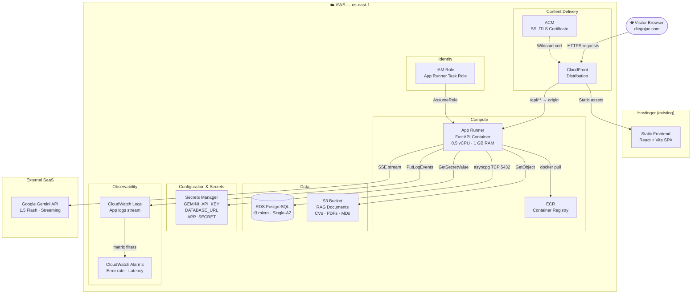
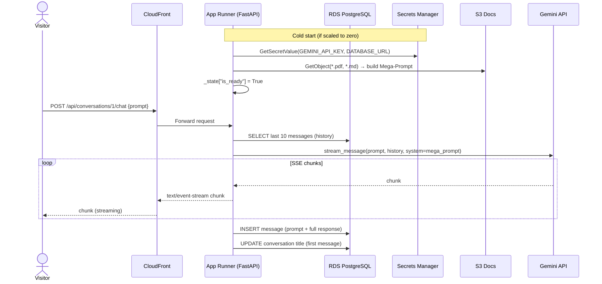
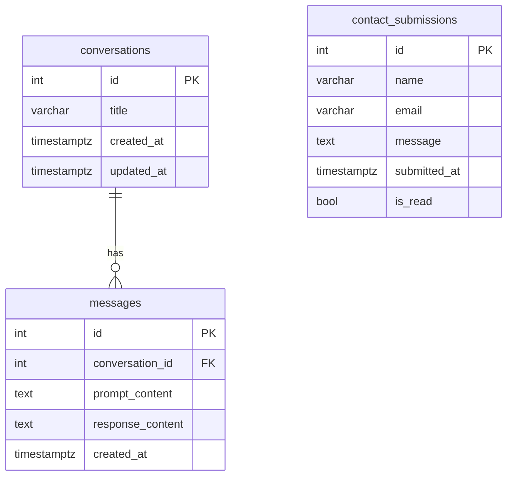
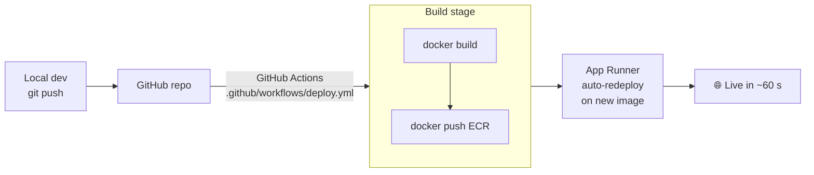

# AWS Architecture — Portfolio AI Backend

## Overview

This document describes the production AWS architecture for Diego's portfolio AI chatbot backend.
The system replaces the ephemeral Render/SQLite setup with a persistent, containerized stack on AWS.

---

## Architecture Diagram

---

## Component Breakdown

### CloudFront Distribution
- Single entry point for all traffic (`diegojpc.com` and `api.diegojpc.com`)
- Routes `/api/*` to App Runner origin; all other paths hit Hostinger static hosting
- Terminates SSL/TLS via ACM wildcard cert (`*.diegojpc.com`)
- Free tier covers the traffic volume of a portfolio site (1 TB out / 10 M requests/month)

### App Runner
- Pulls the Docker image from ECR on every deploy; no SSH required
- Scales to zero automatically when idle — eliminates idle compute cost
- Cold-start penalty: ~15–25 s after inactivity. Acceptable for a portfolio
- SSE streaming works natively (unlike Lambda + API Gateway which impose a 29 s timeout)
- Env vars injected from Secrets Manager at container start via the task IAM role
- Observability: stdout/stderr automatically forwarded to CloudWatch Logs

### ECR (Elastic Container Registry)
- Private Docker registry; 500 MB free storage, then $0.10/GB
- `portfolio-backend:latest` tag updated on each `docker push`; App Runner re-deploys automatically when image changes

### RDS PostgreSQL (t3.micro, Single-AZ)
- Replaces Render's ephemeral SQLite — conversations persist across restarts, redeploys, and sleep cycles
- Automated daily snapshots, 7-day retention (included in price)
- Private subnet — App Runner connects via VPC connector over private IP; not internet-exposed
- Schema managed by Alembic; zero `create_all()` calls in application code

### S3 — RAG Documents Bucket
- Stores `data/*.pdf`, `data/*.md`, `data/*.txt` that power the Mega-Prompt knowledge base
- App Runner loads documents from S3 on startup (falls back to local `data/` if `S3_BUCKET` is not set)
- Uploading a new CV: `aws s3 cp new_cv.pdf s3://diegojpc-rag-docs/` then redeploy App Runner

### Secrets Manager
- Three secrets: `GEMINI_API_KEY`, `DATABASE_URL`, `APP_SECRET`
- Rotatable and auditable (CloudTrail)
- Cost: $0.40/secret/month = $1.20/mo total

### IAM Role (App Runner Task Role)
- Minimum permissions:
  - `secretsmanager:GetSecretValue` on the three portfolio secrets
  - `s3:GetObject`, `s3:ListBucket` on the RAG docs bucket
  - `logs:PutLogEvents`, `logs:CreateLogStream` on the app log group
- No wildcard `*` permissions anywhere

### CloudWatch
- Log group: `/aws/apprunner/portfolio-backend`
- Alarm: `5xxErrorRate > 5%` for 5 minutes → SNS email alert
- Free tier: 5 GB log ingestion, 3 dashboards

---

## Data Flow — Chat Request

---

## Database Schema

---

## Deployment Pipeline (Manual → CI/CD path)

> **Phase 1 (now):** manual `make deploy` from local machine.  
> **Phase 2:** add GitHub Actions workflow — push to `main` → auto-deploy.

---

## Security Notes

| Layer | Control |
|---|---|
| Network | RDS in private subnet; no public endpoint |
| Secrets | All credentials in Secrets Manager; none in environment variables in plain text |
| CORS | Strict origin allowlist (`diegojpc.com` only) |
| Rate limiting | `slowapi` on `/conversations/{id}/chat` — 10 req/min per IP |
| Auth | Stateless `APP_SECRET` HMAC check on write endpoints (future) |
| Container | Non-root user in Dockerfile; read-only root filesystem |
